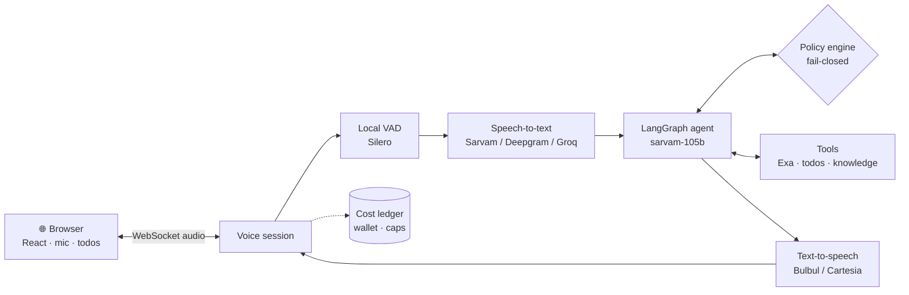

<div align="center">

# 🎙️ Talkstream

**A real-time voice assistant for English, Hindi and Hinglish — with hard spending caps, fail-closed guardrails and reproducible evaluations.**


[Features](#-features) · [How it works](#-how-it-works) · [Quick start](#-quick-start) · [Docs](#-project-documents)

</div>

---

> [!WARNING]
> **Pre-release.** Safety, spending controls and provider qualification are built and tested, but the release gates (permissioned recording corpus, human-calibrated judging, on-host measurements) are still open. Don't expose this build publicly.

## ✨ Features

### 🗣️ Natural voice calls in the browser
- **Streaming speech in, speech out** over a single WebSocket — Sarvam `saaras:v3` recognition, `sarvam-105b` reasoning and `bulbul:v4-flash` synthesis.
- **Speaks your language:** English, Hindi and code-mixed Hinglish.
- **Barge-in:** talk over the assistant and it stops to listen.
- **Local voice activity detection** (bundled Silero ONNX) trims silence before it reaches a paid provider.
- **Phrase chunking** starts playback on the first complete phrase, so replies feel immediate.
- **Live latency HUD** and a transcript drawer for every turn.

### 🧰 Tools the assistant can use
| Tool | What it does |
|---|---|
| `web_search` | Fresh answers from the web via Exa |
| `todo_add` · `todo_list` · `todo_update` · `todo_complete` · `todo_delete` | A todo list stored **in your browser**, never on the server |
| Knowledge base *(add-on)* | Ask questions about your uploaded documents, with vector or hybrid (keyword + vector) retrieval |

Every action the assistant claims to have taken is checked against a **tool receipt**, so it can't say "done" when it wasn't.

### 🛡️ Guardrails that fail closed
- A versioned content policy ([`policy/v1.json`](backend/app/policy/v1.json)) checks requests, proposed tool calls and candidate answers.
- Blocks hidden-instruction and credential disclosure, other users' data, unrequested actions, unverified claims and fabricated citations.
- Documents and web results are treated as **untrusted data**, never as instructions.
- If a required check can't run, the answer is a refusal — not a guess.

### 💸 Spending you can trust
- **Cost ledger:** every provider call reserves an estimate against a rate card and settles to the real amount.
- **Caps everywhere:** per call, per user per day, and for evaluation runs (`LIVE_EVALUATION_CAP_MICRO_INR=0` by default — no paid evals unless you opt in).
- **Mock wallet** with per-minute billing, low-balance warnings and automatic cutoff (not a real payment balance).
- **Usage page** with per-session cost and latency breakdowns; an **admin page** for operations.

### 🔐 Accounts and privacy
- Email OTP sign-in via Resend (console OTP in development), JWT sessions and short-lived voice tickets.
- One-button local login for development (`DEV_LOGIN=true`, loopback only).
- User-supplied provider keys encrypted at rest (Fernet); tokens redacted from logs.
- Data retention, encrypted backups and a recoverable deletion journal.

### 🔌 Swappable providers
Recognition, synthesis and embeddings sit behind adapters, so alternatives can be measured side by side:

| Stage | Default | Also wired up |
|---|---|---|
| Speech-to-text | Sarvam `saaras:v3` | Sarvam realtime, Deepgram Nova-3, Groq Whisper |
| Language model | Sarvam `sarvam-105b` | `sarvam-105b-conversations` |
| Text-to-speech | Sarvam `bulbul:v4-flash` | Sarvam `bulbul:v3`, Cartesia Sonic |
| Search | Exa | — |

## 🧭 How it works



| Layer | Stack |
|---|---|
| Backend | Python 3.11+, FastAPI, LangGraph, SQLAlchemy + SQLite (FTS5), ONNX Runtime |
| Frontend | React 19, TypeScript, Vite |
| Knowledge add-on | Qdrant, OpenAI / OpenRouter embeddings |
| Deploy | Docker Compose, nginx, systemd |

## 🚀 Quick start

**Prerequisites:** Python 3.11+, Node.js, and a [Sarvam](https://dashboard.sarvam.ai) API key for live calls.

```bash
# Backend
python -m venv .venv && source .venv/bin/activate
pip install -e "./backend[dev]"
cp backend/.env.example backend/.env
# edit backend/.env: set JWT_SECRET (openssl rand -hex 32), SARVAM_API_KEY, and DEV_LOGIN=true
cd backend && uvicorn app.main:app --reload
```

```bash
# Frontend (in a second terminal)
cd frontend && npm ci && npm run dev
```

Open **http://localhost:5173** and sign in. Optional keys (`EXA_API_KEY`, `RESEND_API_KEY`, `DEEPGRAM_API_KEY`, …) unlock web search, real email OTP and alternate providers — every option is documented in [`backend/.env.example`](backend/.env.example).

> [!NOTE]
> Voice admission needs a current rate card (`RATE_CARD_FILE`). The bundled [`config/rates/example.json`](config/rates) is synthetic and deliberately cannot enable live calls.

### Tests

```bash
cd backend && python -m pytest && ruff check . && ruff format --check .
cd frontend && npm test && npm run typecheck && npm run build
```

CI runs both suites on every push. Live provider tests need their own credentials and an explicit spending cap.

## 🗂️ Repository layout

```
backend/
  app/          FastAPI app: auth, voice, policy, costs, wallet, analytics, knowledge, operations
  tests/        pytest suite
frontend/src/   React UI: call, usage, wallet, guardrails and admin pages
deploy/         nginx, systemd and backup guides
config/rates/   rate-card examples
```

## 📚 Project documents

- [Backups](deploy/backup.md)

---

<div align="center">
<sub>Built to run on a monthly ceiling of ₹2,000 with limited usage. Credentials and user data are never committed.</sub>
</div>
